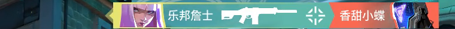

# BUG 记录

剪片时踩到的问题按时间倒序追加，一条一个编号。修完在「状态」里改成已修并写上提交/版本，
验收清单留着当回归用例。

| # | 问题 | 状态 |
|---|---|---|
| 1 | 敌方击杀被误判成「本机击杀」，成片开头多剪一段自己被杀 | **已修**（2026-11-23，源码；待发版） |

---

## #1 敌方击杀被误判成「本机击杀」

- **状态**：已修（2026-11-23 记录 / 同日修复，源码；插件需重新打包安装才生效）
- **严重度**：高 —— 剪错片段（成片首段是死亡画面），击杀数虚高 1，段数虚高 1
- **影响面**：JS 引擎与 PS 引擎**都中**（`normalizeKillText` / `Get-LocalKillText` 逐行对应）
- **素材**：`Valorant 2026.11.21 - 20.20.41.03.DVR.mp4`（2560×1440，195 行 OCR）
- **触发条件**：① 击杀者为拉丁字母 ID（`ToneAim`）；② 本机 ID 是中文（`乐邦詹士`，才会走「剥前缀噪声」
  这条分支）；③ 受害者是本机 —— 三者同时成立

### 现象

6.0s 那条根本不是我的击杀，却被当成击杀剪进成片：

- 真实 killfeed 是 `ToneAim ［步枪图标］ 乐邦詹士`，**左侧杀手是红底（敌方）**，我的头像只出现在
  被击杀方（右侧，金框）；
- 工具输出的这一条只有 `6.00s  乐邦詹士` ——「被杀者」这一栏是空的，剩下的正好是本机 ID，
  于是被当成了「我杀了谁」。

| 伪击杀行（6.0s） | 真击杀行（68.5s） |
|---|---|
|  |  |
| 行首红底 `ToneAim`，我方在右侧 | 行首青绿底 + **金框** `乐邦詹士`，受害者在右侧 |

两次截图的差别就是本机 ID 在「杀手位」还是「受害者位」，而这正是本次误判要看的东西。

### 复现（端到端，约 50s）

```powershell
node scripts\highlight.mjs --source 'C:\Users\xiaoyu\Videos\VALORANT\Valorant 2026.11.21 - 20.20.41.03.DVR.mp4' `
  --release --models 'D:\AIworks\AutoReel\dist\stage\package\models' --keep-work --out 'D:\AIworks\AutoReel\out\_bugrepro'
```

实际输出（节选）：

```
   自动判定本地 ID: 乐邦詹士
   命中本地玩家击杀的行 49 条
[3/4] 按屏幕占位重建 -> 击杀事件 ...
      6.00  slot=1  1.000  乐邦詹士            ← 误检：敌方击杀，没有受害者名
     68.50  slot=0  1.000  乐邦詹士香甜小蝶
     88.50  slot=1  1.000  乐邦詹士有时差的雨
     91.00  slot=0  0.824  乐邦詹士有时差的雨e
     98.00  slot=0  1.000  乐邦詹士ToneAim     ← 真击杀：我杀 ToneAim，文本顺序相反
    115.50  slot=1  1.000  乐邦詹士张雪峰
[4/4] 切片 + 拼接 ...
   #1     2.50s + 5.00s  乐邦詹士              ← 多出来的就是这一段
   #2    65.00s + 5.00s  乐邦詹士香甜小蝶
   ...
      27.52 s   6 次击杀 → 5 段   52.3 MB
```

复跑出来的 `out\_bugrepro\highlight_reel.mp4` 与出问题的那条
`out\2026.11.21 - 20.20.41.03\highlight_reel.mp4` **SHA256 完全相同**
（`F055FDA939DF…`），确认是同一个判定路径、可稳定复现。

去掉误检应是 **5 次击杀 → 4 段、22.5s**。同一局里 `6.0s`（他杀我）和 `98.0s`（我杀他）两个方向都有，
工具只能靠字符串顺序区分，而下面这一步把顺序抹掉了。

### 根因

`scripts/lib/events.mjs` 的 `normalizeKillText`（PS 侧 `scripts/lib/events.ps1:28` 的 `Get-LocalKillText`
同构）有两段逻辑撞在一起：

1. **剥掉开头的非汉字噪声**（`events.mjs:27`、`:52-55`）——本意是修两种 OCR 偏差：武器/头像图标被读成
   字母（`IV 比奇堡恶霸鱼…`）、首字漏识别（`奇堡恶霸鱼…`）。实现是
   `key.replace(/^[^\u4E00-\u9FFF]+/u, '')`，**把所有开头的拉丁字母一起剥掉**；
2. **前缀匹配**（`events.mjs:64`）——剥完的 `key` 以本机 ID 开头就算「我的击杀」。

于是 `ToneAim 乐邦詹士` 走完这两步变成：

```
去空格/标点  ToneAim乐邦詹士  →  剥开头非汉字（ToneAim 整个没了）  乐邦詹士
→ startsWith('乐邦詹士') 成立 → 判为我的击杀，且 key 里已经不剩任何受害者名
```

`ToneAim` 是**别人的名字**，却被当成 `IV`、`G`、`m` 那种「图标读出来的 1–2 个字母」吃掉了。
剥前缀这条规则天然无法区分「图标噪声」和「敌方拉丁 ID」——两者的差别只在长度和语义上。

### 为什么现有用例没挡住

`scripts/test-events.mjs` 的 48 项全过（修复后扩到 64 项，见验收清单），因为匹配用例里只有
「图标噪声 + 中文本机 ID」的组合：

```
[PASS]  IV 比奇堡恶霸鱼 being   → 比奇堡恶霸鱼being     ← 正当用途
[PASS]  G 比奇堡恶霸鱼原神转瓦 → 比奇堡恶霸鱼原神转瓦
```

没有一条是「**敌方拉丁名 + 本机中文 ID**」（正是本次的反例），也没有断言「归一化结果里必须留下受害者」。

### 实测数据（可复算）

对本次 195 张有文本的裁剪图跑 `kfocr --marker 0.5`，量「行首 50% 淡黄占比」：

| 行 | 帧数 | marker | 结论 |
|---|---|---|---|
| `ToneAim 乐邦詹士`（伪） | 10（t=6.0–10.5，随列表上移换了槽位） | **全部 0.000** | 行首没有金框 → 不是我杀的 |
| 含本机 ID 的其余 39 行 | 39 | 中位数 3.937，min 0.232 | 行首有金框 |

也就是说「行首黄框」这个信号其实**一直是对的**（本机 ID 本来就是靠它推断出来的），
只是它目前只用于「推断 ID」，没有用于「逐行判定这条击杀是不是我的」。

### 修法建议（已采纳 1 + 2，3 未做）

按代价从小到大，**1 是必须的**，2 是治本，3 视情况：

1. **加不变量：归一化后必须还剩下受害者**（零风险，一处一行）。
   真击杀行的文本 = 本机 ID + 受害者，剥完至少还剩 1 个字符；`key === id` 只可能出现在
   「受害者位被误当成杀手名的前缀剥掉 / 压根没有受害者」这两种坏情况 → 直接 `return null`，
   并记一条 `warn`（带上原始文本与时间），方便回头核。

   这条对本次这一类是**完备**的：剥掉开头的杀手名之后，剩下的必然以**受害者**的名字开头，
   只有受害者正好是本机时，`key` 才会以本机 ID 开头 —— 而此时它一定等于本机 ID（受害者段被剥空）。
   换言之「本机 ID 在受害者位」永远走不到 `key.length > id.length`。

   ```js
   key = key.replace(LEADING_NON_CJK, '')
   ...
   if (key.startsWith(id)) {
     if (key.length <= id.length) return null   // 只剩杀手名，没有受害者 → 不是本机的击杀
     return key
   }
   ```

2. **逐行用行首黄框做否决**（治本，但要回归）。已有 `kfocr --marker`，目前只在
   `highlight.mjs:362` 推断 ID 时用过；把每行裁剪图的 marker 带进 `hits`，`>= minScore` 才收。
   注意具体阈值：本素材 39 个真击杀行里 38 个 ≥3.0（33 个 ≥3.7），但有 1 行（t=73，淡入瞬间）
   只有 `0.232`，硬卡 3.0 会丢真击杀的一帧。稳妥写法是「marker < minScore **且** `key === id`」才否决，
   或阈值放宽到 0.1。

3. **保守化剥前缀**：只在剥掉的串很「像噪声」时才剥（长度 ≤2、或只含 1–2 个字符的字母段），
   `ToneAim`（7 个字母）就落不进来。代价是 2 个字母的敌方 ID（如 `AB`）仍会误判，只能当补充。

### 修复内容（2026-11-23）

JS（`scripts/lib/events.mjs`）与 PS（`scripts/lib/events.ps1`）逐函数对应地改了三处：

1. **归一化不变量**（建议 1）：`normalizeKillText` / `Get-LocalKillText` 在 `key.startsWith(id)` 之后
   加 `key.length <= id.length → null`；「补回漏识别首字」那条分支同样加这道闸
   （`邦詹士` → `乐邦詹士` 也不收）。剥掉开头杀手名后只剩本机 ID = 本机在受害者位。
2. **逐行金框否决**（建议 2，治本）：`kfocr --marker 0.5` 现在对**所有有文本的行**算一次行首淡黄占比
   （以前只在 auto 推断 ID 时算），既用来推断 ID，也用来逐行判定 —— 新增
   `dropUnmarkedHits` / `Select-SelfKillHits` 与可用性检查 `markerChannelUsable` / `Test-SelfMarkerChannel`。
   阈值 **0.1**：只判「有没有金框」（真击杀行最低 0.232 是淡入瞬间，敌方行恒 0.000），
   不用 3.0，避免把淡入那一帧真击杀丢掉。金框通道不可用（ROI 没框住头像框 / 老 kfocr 没有
   `--marker`）时退回纯文本判定并打一条告警，不会把整条素材剪空。
   它顺带覆盖了 TODO #1 的撞名场景（同名人杀我、敌杀「名字以我开头」的别人）。
3. **显示层兜底**（「连带要修的」）：`plugin/client.js` 的 `victimOf` 在受害者切完为空时显示
   `（未识别受害者）`，不再渲染成空白栏。

实测（同一份抽帧 + OCR 缓存，`--reuse`）：

| 素材 | 修复前 | 修复后 |
|---|---|---|
| 本素材 `2026.11.21 - 20.20.41.03` | 6 次击杀 → 5 段，27.52s，首段 `2.50s 乐邦詹士` | **5 次击杀 → 4 段，22.52s**，首段从 `65.00s` 开始 |
| 6 条金样素材（`test-parity` 那 6 条） | — | kills / segments / 成片 **SHA256 逐字节相同**（零回归） |

被否决的正是 6.0–10.5s 那 10 帧 `ToneAim 乐邦詹士`（marker 全 `0.000`）。另有一条金样素材
（`2026.11.11 - 23.18.37.03`）多了 1 行逐行否决（11.50s 的 `乐邦詹士困了又困`，同一时段里还有
金框帧），事件与成片都不受影响 —— 这正是「阈值只判有无金框」的预期行为。

### 连带要修的（已修）

- `plugin/client.js:329-332` 的 `victimOf`：`text.slice(localId.length)` 为空时渲染出空字符串，
  界面上就是「受害者栏空白」。根因修完后理论上不会再出现，但显示层应给个 `（未识别受害者）`
  之类的占位，别让人看着像界面坏了。
- `scripts/lib/events.ps1` 的 `Get-LocalKillText` 要同步改，`scripts/test-parity.mjs` 是逐条比对
  localId / kills / segments 的，两边不一致会被它抓出来。

### 验收清单

- [x] `normalizeKillText('ToneAim 乐邦詹士', '乐邦詹士')` → `null`（JS）
- [x] `Get-LocalKillText -Text 'ToneAim 乐邦詹士' -LocalId '乐邦詹士'` → `$null`（PS）
- [x] `normalizeKillText('IV 乐邦詹士', '乐邦詹士')`、`normalizeKillText('G 乐邦詹士', '乐邦詹士')` → `null`
      （同样是「本机在受害者位」，只是噪声段是 1–2 个字母。原清单把这两条写成「仍判为本机击杀」，
      与修法 1 的 `key.length <= id.length → null` 自相矛盾 —— 已按实际语义改正）
- [x] 不回归：`normalizeKillText('IV 比奇堡恶霸鱼 being', '比奇堡恶霸鱼')` → `比奇堡恶霸鱼being`；
      `normalizeKillText('奇堡恶霸鱼搞事早把爱玩机瞄', '比奇堡恶霸鱼')` → `比奇堡恶霸鱼搞事早把爱玩机瞄`
- [x] 重跑本素材：**5 次击杀 → 4 段，22.52s**，不再有 `2.50s` 起的那段
- [x] `node scripts\test-events.mjs`（64 项）/ `pwsh -File scripts\test-events.ps1`（52 项）全过
      （已补本次反例 + 逐行金框用例）
- [x] `node scripts/test-parity.mjs` 6 条素材 JS/PS 逐条一致（kill / segments / 成片 SHA256）
