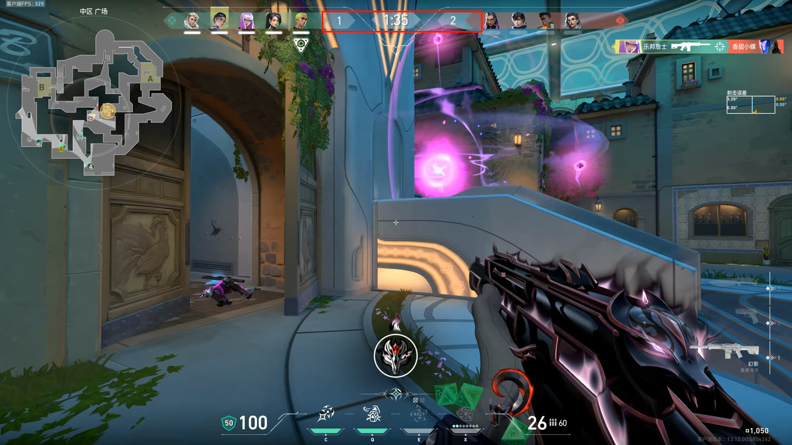
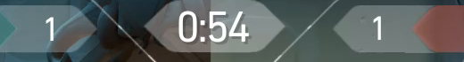
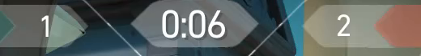

# 待办 / 优化清单

> 剪片过程中发现、但还没做的改进。按优先级排；每条写清「现在怎么做的 → 哪里不行 → 打算怎么改 → 怎么验收」。
> 已经踩实的 bug 记在 [BUGS.md](BUGS.md)，这里只放还没动手的事。

| # | 事项 | 优先级 | 影响 | 状态 |
|---|---|---|---|---|
| 1 | 撞名（同 ID）时判不出哪条击杀是本机的 | P0 | 剪进别人的击杀 / 把自己的死亡当成击杀 | 部分完成（逐行金框已落地；队色 / 结构化字段未做） |
| 2 | 按回合切分（两分钟回放里通常跨 2 个回合） | P1 | 多回合的击杀混成一条时间线、没有回合标注、切片可能伸进买枪画面 | 未开始 |
| 3 | 同屏 4 条以上击杀被漏掉（槽位只有 3 个） | P2 | 漏剪 | 待评估 |

排序理由：#1 是**静默错误**（成片看着正常，但内容是别人的击杀；逐行金框落地后误剪已经不会发生，
剩下的是受害者名显示与队色标注）；#2 是结构问题（不改也能出片，
但回放一跨回合就串味 —— 这条素材就是 R1 结尾 + 买枪 + R2）；#3 目前素材没触发。

---

## 1. 撞名（同 ID）时判不出哪条击杀是本机的

### 现在怎么做的

身份判定**只看文本**：`normalizeKillText`（[events.mjs:47](scripts/lib/events.mjs#L47)）把一行 OCR 文本
归一化，然后判断它是否以本机 ID 开头。行首金框（`kfocr --marker`）只用来**推断**本机 ID 是谁
（[highlight.mjs:350-362](scripts/highlight.mjs#L350-L362)），推断完就丢掉了，**不参与逐行判定**。

### 哪里不行

killfeed 一行就是「杀手名 + 武器图标 + 受害者名」连写，名字之间没有分隔符。一旦文本相同，就分不开：

| 情形 | killfeed 文本 | 现在的行为 |
|---|---|---|
| 敌（或队友）与我同名，他杀了人 | `乐邦詹士 香甜小蝶` | 判成**我的**击杀（假阳性） |
| 敌与我同名，他杀了我 | `乐邦詹士 乐邦詹士` | 判成我的击杀（实际是我死了） |
| 队友与我同名，他杀了人 | `乐邦詹士 张雪峰` | 判成我的击杀（队友的击杀不该剪） |
| 我的 ID 是别人名字的前缀 | `乐邦詹士 香甜小蝶`（本机 ID = `乐邦`） | 判成我的击杀，受害者被截成 `詹士香甜小蝶` |

实测（`node -e` 直接调）：

```
"乐邦詹士乐邦詹士"  -> "乐邦詹士乐邦詹士"   同名人杀我 vs 我杀同名人：文本完全一样，无法区分
"乐邦詹士ToneAim"  -> "乐邦詹士ToneAim"   我杀 ToneAim
"ToneAim乐邦詹士"  -> "乐邦詹士"          敌方杀我（另见 BUGS #1，拉丁名被剥掉）
"乐邦詹士香甜小蝶"  -> "乐邦詹士香甜小蝶"   本机 ID=乐邦，别人的名字以它为前缀 → 假阳性
```

补充说明：

- **两个敌人互相同名**（都不是我）对「找我的击杀」没有影响，只会在将来按对手名字做统计/标注时产生歧义；
- 撞名不影响本机 ID 的**推断**（推断只用金框行），坏在**逐行使用**这一步；
- 文本这个信号本身就不具备唯一性：10 人局里 Riot ID 只显示名字、不带 `#TAG`，重名是合法状态。

### 已有的、还没用起来的信号

| 信号 | 含义 | 实测 |
|---|---|---|
| 行首 50% 淡黄占比（`--marker`） | 本机在**杀手位**（金色头像框） | 真击杀行 3.6–6.3（中位数 3.9），敌方行 **0.000**（39 行 vs 10 行，见 BUGS #1） |
| 队色（左半区红/绿） | 杀手是敌方（红）/ 队友（青绿） | 截图可辨：红底 = 敌方击杀，青绿底 = 我方 |
| 受害者侧队色 | 只影响展示（我杀敌 / 我杀友） | 同上 |

也就是说：**名字不唯一，但「谁的头像在行首、什么颜色」是唯一的**。队友框是青色，不会命中淡黄判定，
所以金框天然只认「本机」。直观对照：[红底 = 敌方击杀](docs/bug-assets/bug1-false-positive-6s.png) /
[金框 = 本机击杀](docs/bug-assets/bug1-true-kill-68s.png)。

### 打算怎么改

1. **把 marker 提升为逐行判据**：`hits` 里加 `marker`（0–100）与队色字段；只有 `marker >= minScore`
   的行才可能是「我的击杀」，文本前缀退化成**辅助**（用于切受害者名、做 OCR 容错）。
2. **kfocr 加 `--color`**：和 `--marker` 同一次解码里顺手算左半区的红/绿占比
   （[kfocr/src/main.rs:33](kfocr/src/main.rs#L33) 的 `marker_score` 已经有采样骨架，加两条判据即可），
   这样能区分「敌杀我」与「我杀敌」，也能给卡片提供「红/绿」信息。
3. **事件保留结构化字段**：`killer` / `victim` / `marker` / `team`，卡片显示「我 → 香甜小蝶」而不是裸文本。
4. **退化路径**：ROI 把金框裁掉、marker 全为 0 时，退回文本判定并打一条告警（别静默剪错）。

### 已完成的部分（2026-11-23，随 BUGS #1 一起落地）

- 上面的第 1 条**已落地**（阈值没按 3.0，而是 0.1）：`highlight.mjs` / `highlight.ps1` 对所有
  「有文本的行」量一次行首金框，`dropUnmarkedHits` / `Select-SelfKillHits` 逐行否决，
  `markerChannelUsable` / `Test-SelfMarkerChannel` 负责金框不可用时退回文本判定并告警。
  本表 4 个撞名用例全部变成「0 次击杀 / 1 次击杀」的正确结果，用例见 `test-events.mjs` 的
  「行首金框」小节。
- 上面的第 4 条**已落地**（同一个可用性检查）。
- 还没做：第 2 条 `kfocr --color`、第 3 条结构化字段（`killer` / `victim` / `team`）。
  剩余的误判面：**行首金框也在、但文本切不出正确受害者**的情况（比如我的 ID 是别人名字的前缀，
  受害者名会被切错），这要靠第 3 条才能显示对。

### 代价

- Rust 侧约 30 行（`--marker` 已有采样循环，复用即可），不增加任何抽帧；
- JS/PS 两侧的 `hits` schema、`kills.json`、插件卡片各加一个字段；
- 与 BUGS #1 共用同一条「逐行 marker」链路，**建议一起做**：先落 BUGS #1 的一行兜底（`key.length <= id.length → null`），
  再做这里的 marker 逐行化。

### 验收

- [x] 合成用例（`test-events.mjs` 的「行首金框」小节 + `test-events.ps1` 对应小节，各 7 条）：
  - `乐邦詹士乐邦詹士` + marker 3.8（我杀同名人）→ 1 次击杀
  - `乐邦詹士乐邦詹士` + marker 0.0（同名人杀我）→ 0 次击杀
  - `乐邦詹士香甜小蝶` + marker 0.0（同名人杀别人 / 前缀撞名）→ 0 次击杀
  - `乐邦詹士ToneAim` + marker 3.8（正常击杀）→ 1 次击杀（不能被 marker 卡掉）
- [x] 真素材回归：本素材 39 个真击杀行 marker 最低 0.232、伪击杀行全 0.000 → 判定结果符合预期
  （本素材误检被去掉；6 条金样素材 kills / segments / 成片 SHA256 逐字节不变）
- [ ] 结构化字段（`killer` / `victim` / `team`）与 `kfocr --color`：未做

---

## 2. 按回合切分（两分钟回放里通常跨 2 个回合）

### 现在怎么做的

一条回放当成**一条连续时间线**：`killEvents` 只按时间和槽位聚，`highlightSegments` 只按间隔并段，
输出里没有「回合」这个概念。于是跨回合的击杀被当成同一串「连续战绩」列出来 —— 这条素材按工具的
口径是 5 次击杀（去掉 BUGS #1 的伪击杀后，实际 4 次：`88.5` 与 `91.0` 是同一次击杀的两种 OCR 写法），
它们分属 R1 和 R2 两个回合，而界面上没有任何提示；也没法只挑最后一个回合出片。

### 这条素材实测（`2026.11.21 - 20.20.41.03`）

读的是**顶部中央那块「比分 + 倒计时」**（两侧是两队头像列），2560×1440 下的裁剪框是
`x=1040..1560, y=35..105`：



放大来看就是「左 = 我方回合数，中 = 倒计时，右 = 敌方回合数」：


采样方式：1–2s 取一帧 → `ffmpeg crop` → `kfocr` 识别 → 按「比数 / `m:ss`」解析；关键时间点再用
`-ss` 精确取帧复核过（不是靠 `fps=1` 的近似时间戳）。

| 视频时间 | HUD（比分 / 倒计时） | 判定 |
|---|---|---|
| 0s | 1:1 / 1:21 | R1 中段（回合在录制开始前就开了） |
| 28s | 1:1 / 0:54 | R1 最后一秒 |
| 29s | 1:2 / 0:06 | 屏幕中央出现「败」→ **回合结束倒计时**（不是回合时钟） |
| 34s | 1:2 / 0:00 | 倒计时归零 |
| 36–64s | 1:2 / 0:28→0:00 | 买枪阶段 |
| 65s | 1:2 / 1:39 | **R2 开局** |
| 70s | 1:2 / 1:35 | R2 中段（上面那张标注图） |
| 90s | 1:2 / 1:14 | R2 中段 |
| 92–112s | 1:2 / 数字被覆层挡住 | 读不到，只能靠比分兜底 |
| 116s | 2:2 / 0:06 | 「获胜」→ **R2 结束倒计时**（115.5s 那杀是制胜杀） |

回合结束那一秒前后各取一帧（同一块 HUD，相隔 1 秒）：

| 28s | 29s |
|---|---|
|  |  |
| 比分 1:1，倒计时 **0:54** | 比分 1:2，倒计时 **0:06** |

结论：

1. **这条 120s 里正好 2 个回合**：R1（0–28.3s，我方被打败）→ 买枪（~35–64s）→ R2（65–115.5s，我方获胜）。
   和「两分钟的即时回放大概率两个回合」一致。
2. **0:54 → 0:06 不是时钟跳动**：回合结束时那块六边形会换成「下一回合倒计时」，同时屏幕中央出现「败」。
   两种状态长得一模一样（都是 `m:ss` 递减到 0:00），把它们混为一谈就会得出「录制丢块」的错误结论
   —— 我第一版就是这么读错的，已按实测改掉。
3. 倒计时在 92–112s 被覆层挡住（读不到数字），这段只能靠比分判断，别硬猜。

### 这条对设计的影响

- **边界主判据是比分**（回合结束比分必变），倒计时只能做辅助：单看数字区分不了「回合时钟」和
  「回合结束倒计时」，会把一次回合结束读成时钟跳变，甚至把那个 6s 倒计时当成一段"回合"。
- 需要一条辅助判据来定位边界时刻：顶部中央的**「胜/败」大字**（29s、116s 都有），或者
  「0:00 → ~0:30（买枪） → 1:39（开局）」这个形状。
- 击杀归属（按上表推）：`6.0 → R1`；`68.5 / 88.5 / 91 / 98 / 115.5 → R2`；其中 `115.5` 是 R2 的制胜杀，
  打完整局立刻「获胜」——正好是「回合边界与最后一次击杀重合」的例子。

### 打算怎么改

1. **新增 HUD ROI**（顶部比分 + 倒计时）：2560×1440 下实测可用的是 `x=1040..1560, y=35..105`；
   按「高度 / 1440」等比缩放、**水平居中**（不像击杀条那样贴右）。`lib/roi.mjs` 里已有按分辨率换算的写法，照抄。
2. **低帧率采样**：2s 一张（120s → 60 张），`ffmpeg` 和击杀条抽帧共用一次解码（现有 `split=3` 扩成 `split=4`）。
   OCR 只认「比分 + `m:ss`」，正则解析，别用整行文本。
3. **回合边界判据**（按可靠性排序，已按实测修正）：
   - **比分变化** → 边界（最可靠：回合结束比分必变，且不受倒计时歧义影响）；
   - 比分没变、但顶部中央出现**「胜/败」大字** → 用横幅出现的那一帧做边界；
   - 「0:00 → ~0:30（买枪） → 1:39（开局）」这个形状 → 新回合起点取 1:39 的那一帧；
   - 读不到（被覆层挡住）→ 沿用上一个已知比分，标成 unknown，不要硬猜；
   - **不要**把「倒计时从 0:54 掉到 0:06」当成时钟跳变：那是回合结束后的下一回合倒计时。
4. **事件带回合号**：`kills.json` 里每条 kill 加 `round`；段按回合分组；卡片用分隔行
   「—— 第 2 回合 ——」；`--rounds latest|all`（默认 `all`，但**默认按回合分组展示**，
   多数时候其实只想要刚打完的那回合）。
5. **段不跨回合起点**：R2 从 65s 开始，第一杀 68.5s 的前摇正好落在 65.0s；要是那杀早两秒，
   前摇就会伸进买枪画面。所以段的 `start` 要钳到 `round_start`。跨回合的段本来不会合并
   （`mergeGap` 4.5s 远小于买枪 30s），但要用 round 分组显式保证，别靠时间差侥幸。

### 代价

- 抽帧 +60 张（HUD 区域很小，解码开销可忽略），OCR 60 张 × ~90ms ≈ **+5–6s**（当前端到端 ~50s）；
- 新增 HUD ROI 常量 + 一份「比分/时钟」解析（~60 行），`lib/events.mjs` 加回合标注与分组；
- 卡片/工具输出多一层分组，`kills.json` 结构变化（属于内部接口，插件同步即可）。

### 验收

- 本素材：识别出 **2 个回合**（R1 结束于 28.3s、R2 起于 65s），买枪阶段（~35–64s）里不该有击杀段；
- 击杀归属：`6.0 → R1`，`68.5 / 88.5 / 91 / 98 / 115.5 → R2`；R2 第一段的起点不得早于 65s；
- 回归：回合结束那个 `0:06` 倒计时不得被当成回合时钟（即不产生多余的回合边界）；
- 单回合素材不得产出边界（抽 2–3 条人工核对；`out/_parity` 的 6 条金样可直接跑）；
- 插件卡片按回合分组后，击杀列表与 `kills.json` 的 `round` 一致。

---

## 3. 候选（待评估，先记下来）

- **槽位 3 → 5**：同屏 4 条以上击杀时看不到最新那条（README「已知限制」）。代价是 OCR 次数 +67%
  （720 → 1200 张），当前素材没触发，等踩到再做。
- ~~**受害者名缺失时的显示**：`victimOf` 返回空字符串会渲染成空白栏~~ → **已修**（2026-11-23，
  见 BUGS #1 的连带项：现在显示 `（未识别受害者）`）。
- **一个目录一次剪完**：现在一次只能剪一条回放，`--source` 加目录语义即可，属于便利性优化。
